<div align="center">
  

  
</div>

```text
   .        *         .            .        *          .         *
       .         .         *        __        .    .         .
  (O)  - - - - - - - - - - - -  >==[__]>  - - - - - - - - - - - (*)
  SOL      *        .        .         *     ~1,2 x 10^1 a.l.   TAU CETI
```

## 📓 Registro do tripulante

> **Diário de bordo · registro 2026.300**

Os sistemas reiniciaram e a primeira coisa que voltou foi o crachá: **Pedro Henrique**, **Analista DevOps Júnior na CSD BR** desde fevereiro de 2026, base em São Paulo, Brasil.

O resto da memória veio em camadas. Primeiro a física: **Eletroeletrônica**, depois **Análise e Desenvolvimento de Sistemas** e Técnico em Desenvolvimento de Sistemas pelo **SENAI**. Anos entre ESP32, Arduino, C++, MQTT, HTTP, LoRa e CAN me ensinaram a respeitar detalhes, telemetria e falhas sem glamour, porque sistema embarcado não aceita "na minha máquina funcionou".

Então veio a hipótese que mudou a rota: os princípios de confiabilidade que mantêm um dispositivo vivo valem para a plataforma inteira ao redor dele. Assim nasceu o DevOps. **Objetivo da missão:** deploys repetíveis, segredos no lugar certo, clusters observáveis e menos espaço para improviso.

## 🛰️ Sistemas da nave

| Subsistema | Equipamento |
| :-- | :-- |
| ☁️ **Órbita** · cloud |  |
| 🚀 **Propulsão** · containers e orquestração |   |
| ⭐ **Navegação** · CI/CD e GitOps |    |
| 📡 **Sensores** · observabilidade |   |
| 🧪 **Laboratório** · dados e infra distribuída |   |
| ☀️ **Suporte de vida** · sistema |  |
| 🔬 **Módulo de origem** · raízes embarcadas |     |

## 🧪 Experimentos em andamento

**EXPERIMENTO #1 — Sealed Secrets → External Secrets Operator** · Status: 🟢 padrão aplicado em 3 × 10⁰ ambientes

- **Hipótese:** segredos espalhados entre manifestos ficam mais seguros e simples de manter com uma fonte de verdade adequada ao ambiente.
- **Procedimento:** liderei a migração de **Sealed Secrets** para **External Secrets Operator (ESO)**, com **AWS Secrets Manager** como backend, em todos os ambientes: **dev, QA e HML**.
- **Resultados:** segredos desacoplados dos manifestos versionados · gestão centralizada e mais flexível das credenciais · fluxo alinhado ao GitOps · base mais limpa para rotação, manutenção e evolução dos ambientes.

**EXPERIMENTO #2 — Gerenciador de nodes Cassandra** · Status: 🟢 ativo nos ambientes de QA para baixo

- **Hipótese:** manutenção de Cassandra não pode depender de lembrete, planilha ou intervenção manual toda vez que algo precisa acontecer.
- **Procedimento:** lidero uma ferramenta própria para gerenciar nodes Cassandra, com **agendamento automatizado de repairs**, monitoramento dos clusters e o **Cassandra Reaper** operando por trás da aplicação.
- **Resultados:** rotinas recorrentes tratadas como processo, não como tarefa avulsa · mais visibilidade sobre o estado dos clusters · operação mais previsível nos ambientes não produtivos · menos atrito para quem cuida da plataforma no dia a dia.

## 📡 Telemetria

<div align="center">
  <a href="https://github.com/PhrL0">
    <picture>
      <source media="(prefers-color-scheme: dark)" srcset="./profile/stats-dark.svg" />
      <source media="(prefers-color-scheme: light)" srcset="./profile/stats-light.svg" />
      
    </picture>
  </a>
  <a href="https://github.com/PhrL0">
    <picture>
      <source media="(prefers-color-scheme: dark)" srcset="./profile/top-langs-dark.svg" />
      <source media="(prefers-color-scheme: light)" srcset="./profile/top-langs-light.svg" />
      
    </picture>
  </a>
  <br />
  <picture>
    <source media="(prefers-color-scheme: dark)" srcset="https://streak-stats.demolab.com?user=PhrL0&locale=pt_BR&hide_border=true&background=00000000&ring=F5B700&fire=E23D28&stroke=F5B700&currStreakNum=E6EDF3&sideNums=E6EDF3&currStreakLabel=FFC94A&sideLabels=E6EDF3&dates=E6EDF3" />
    <source media="(prefers-color-scheme: light)" srcset="https://streak-stats.demolab.com?user=PhrL0&locale=pt_BR&hide_border=true&background=00000000&ring=F5B700&fire=E23D28&stroke=E23D28&currStreakNum=111827&sideNums=111827&currStreakLabel=E23D28&sideLabels=111827&dates=111827" />
    
  </picture>
  <br />
  <picture>
    <source media="(prefers-color-scheme: dark)" srcset="https://raw.githubusercontent.com/PhrL0/PhrL0/output/github-contribution-grid-snake-dark.svg" />
    <source media="(prefers-color-scheme: light)" srcset="https://raw.githubusercontent.com/PhrL0/PhrL0/output/github-contribution-grid-snake-light.svg" />
    
  </picture>
</div>

## 📻 Canal de comunicação

<div align="center">

♪ &nbsp; frequências de contato abertas &nbsp; ♫

<a href="https://www.linkedin.com/in/pedroleme11"></a>
<a href="mailto:ph137163@gmail.com"></a>


♫ &nbsp; ♪ &nbsp; ♫

</div>

<details>
<summary>📁 <b>Arquivos confidenciais da missão</b></summary>

<br />

- 🎬 Gênero preferido no cinema: romance e drama. Se tem Ryan Gosling no elenco, a probabilidade de eu assistir tende a 1. A temporada anterior deste perfil se passava sob uma *City of Stars*: mesmo ator favorito, outra galáxia.
- ♪ Maior passatempo: ouvir música, de qualquer gênero. O receptor da nave não filtra frequência.
- 🔬 Filosofia, principalmente a existencial. Autor favorito: **Albert Camus**. Rodar o mesmo pipeline todo dia e ainda encontrar sentido nisso é praticamente um exercício de Sísifo.
- 🔌 Antes de clusters, eram sensores: LoRa e barramento CAN estão no currículo de origem.
- 📏 Tolerância a "na minha máquina funcionou": 0 × 10⁰.
- 🔐 Ambientes migrados para External Secrets Operator: 3 × 10⁰ (dev, QA e HML).
- 🌌 Distância até Tau Ceti: ~1,2 × 10¹ anos-luz. Distância até o próximo deploy: menor.

</details>

<div align="center">
  <br />
  <code>🛰️ STATUS: Missão em andamento. Combustível: café. ☕</code>
  <br /><br />
  
  <br /><br />
  
</div>
